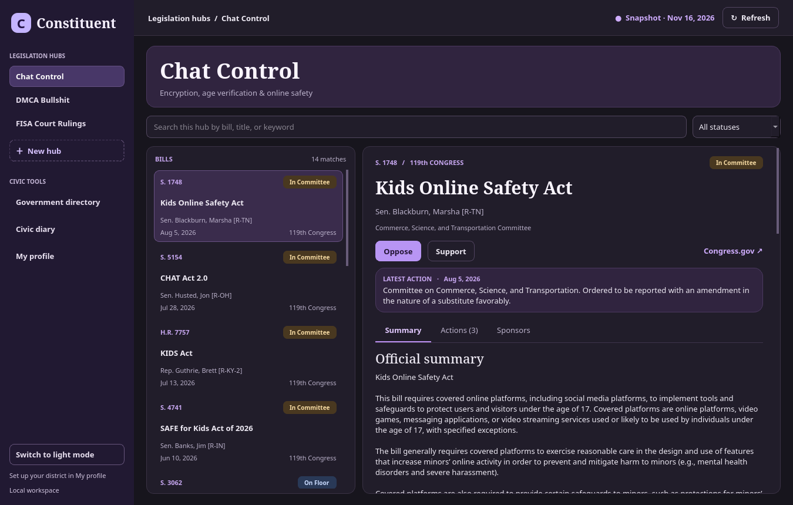

# Constituent

**Public alpha** · Linux desktop · MIT

Constituent is a Linux desktop app for tracking U.S. federal bills and preparing constituent letters. It opens offline with 16,732 House and Senate bills from the 119th Congress, a 539-office congressional directory, and recent Foreign Intelligence Surveillance Court filings. The bundled records were retrieved on November 16, 2026.



## Install and run

Requires Linux, Python 3.12 or newer, and a desktop session. Install the local wheel with [pipx](https://pipx.pypa.io/). pipx installs PySide6 and its Qt runtime with the app.

```sh
pipx install ./constituent-0.2.0-py3-none-any.whl
constituent
```

Dark mode is the default. Use **Switch to light mode** in the sidebar to change it. Constituent remembers your choice across launches.

Start with `constituent --offline` to skip automatic refresh. The **Refresh** button still works in this mode. For source development, extract the source archive and run `pipx install .` from its root, or run `PYTHONPATH=src python -m constituent --offline` with PySide6 already installed.

## Track a bill and contact an office

1. Open **Chat Control**, **DMCA Bullshit**, or **FISA Court Rulings**, or create a hub from comma-separated search phrases. Use the status filter or search inside a hub. For FISA court material, open **Court filings**.
2. Save your name, mailing address, state, and U.S. House district in **My profile**. The House.gov lookup opens separately if you need your district. Constituent matches the saved state and district against the cached office roster.
3. Select a bill, choose **Oppose** or **Support**, and select an office. Edit the preview if needed. The app opens an email draft if its source provides an email address. With the current roster, the app copies the letter and opens the relevant contact page or official office site. Paste the letter and submit it there. A separate **Copy subject** button is available for forms with a subject field.
4. Use **Civic diary** to review the handoff and mark it sent after you submit it. The app has no access to your mail client's outbox or the office's form submission status.

The default letter bodies are in `${XDG_CONFIG_HOME:-~/.config}/constituent/templates/`. They support `{{bill_id}}`, `{{bill_title}}`, `{{bill_stage}}`, `{{official_name}}`, `{{official_title}}`, `{{stance}}`, `{{user_name}}`, and `{{user_address}}`.

## Official data and refresh

- **Legislation.** [GovInfo Bill Status](https://www.govinfo.gov/bulkdata/BILLSTATUS) archives supply H.R. and S. measures, CRS summaries when available, sponsors, committees, action timelines, and linked floor votes. The bill record links back to Congress.gov. A lifecycle badge follows explicit milestones so, for example, a rule vote does not read as a vote on the bill. A passed House bill can return to **In Committee** when it is referred in the Senate.
- **Directory.** [Office of the Clerk](https://clerk.house.gov/xml/lists/MemberData.xml), [House.gov](https://www.house.gov/representatives), and the [Senate’s contact feed](https://www.senate.gov/general/contact_information/senators_cfm.xml) supply sitting members and delegates, published phone numbers, Capitol office addresses, and official websites or contact links. A vacancy or district without a current office record may reduce the available contacts.
- **Court filings.** The first page of the [FISA Court’s public-filing index](https://www.fisc.uscourts.gov/public-filings) supplies recent filing titles and dates. The app opens the official filing externally.

The app refreshes on startup and every four hours while open, matching GovInfo’s stated bulk-update cadence. The initial refresh may download both bill archives, roughly 45 MB for the bundled Congress. Subsequent refreshes use conditional requests where the source provides cache validators. New actions in matched bills get an in-app badge and a notification when the session supports desktop notifications. A source failure leaves the previous cache available. Open the sync status to see refresh errors.

SQLite lives under `${XDG_DATA_HOME:-~/.local/share}/constituent/`. The saved address is local and unencrypted, protected by the user’s filesystem permissions. Public-data refresh requests do not carry profile data. Opening a draft or copying a letter passes the text to the chosen application or the system clipboard.

## Release scope

This alpha covers federal legislation, congressional offices, and recent FISA filings. It uses the keyless GPO and chamber feeds. Google retired the Representatives API in April 2025, so local matching uses a district you select. Individual roll calls open at the official source. The app includes sponsorship on tracked hubs in each office profile.

The GitHub alpha includes a wheel and an MIT-licensed source archive with an Arch recipe. AUR and PyPI publishing are separate release steps. An AppImage, automatic street-address resolution, full vote joins, executive and state directories, SMTP, and trend charts are outside this build.

## Verify or refresh the snapshot

```sh
PYTHONPATH=src QT_QPA_PLATFORM=offscreen python -m unittest discover -s tests -v
PYTHONPATH=src python tools/make_snapshot.py --congress 119
```

The application architecture keeps PySide6 at the interface boundary. The official-source parsers, refresh service, local cache, and letter renderer are pure Python.
